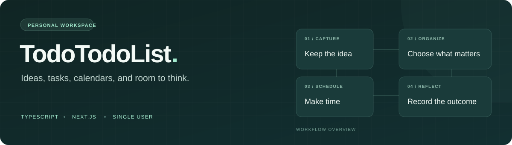

# TodoTodoList



**把想法、任务、日历，以及决定不做的事，放进一个个人工作台。**

[English](README.md) · [部署与集成](docs/setup-and-integrations.md) · [参与贡献](CONTRIBUTING.md) · [报告问题](https://github.com/dailyun/TTL/issues/new?template=bug_report.yml)

先收集零散想法，再决定要不要做、什么时候做，最后记录实际反馈。需要时，可以连接 Markdown 文件、GitHub 快照、Google Calendar 和外部工具。

项目仍在持续开发，面向单用户使用。可以先用合成示例本地体验；日历授权和手机推送需要单独配置、验收。

## 适合哪些场景

| 你的需求 | 项目提供的能力 |
| --- | --- |
| 随手记下想法与截图 | 收集箱、想法、任务、事件、沉淀记录 |
| 从一堆事项里选出今天要做的事 | 今日、正在、列表、看板、日历，支持筛选与自定义版块 |
| 给不值得做的事设边界 | 带时间范围的反向待办 |
| 保留可读的 Markdown 笔记 | YAML frontmatter 导入与只修改 frontmatter 的回写 |
| 让计划连接真实日历 | 可选 Google Calendar 导入、创建、编辑与删除 |
| 从脚本或其他工具操作任务 | Bearer token REST API 与 OpenAPI 描述 |
| 记录执行结果 | 显式完成、回顾、反馈与 PWA 离线反馈队列 |

## 本地体验

需要 Node.js 22（与 CI 一致）、npm 和 Git。基础本地工作台不需要 GitHub token、Google 账号或 AI API key。

```bash
git clone https://github.com/dailyun/TTL.git
cd TTL
npm ci
npm run local-git:seed
npm run dev
```

打开 [http://127.0.0.1:3000](http://127.0.0.1:3000)：

1. 在收集箱新增想法或任务，打开详情修改状态与版块。
2. 切换列表、看板和日历，查看同一批事项。
3. 打开 Sync 视图，导入本地 Git 合成示例。重新执行 seed 只会重建 `.tmp/local-git-repo`。
4. 尝试 JSON 导出与导入，了解数据备份流程。

本地默认不启用密码登录。对外部署前，请按[环境配置](docs/setup-and-integrations.md#environment)启用鉴权。

## 按需连接

- [部署与环境变量](docs/setup-and-integrations.md)：Node.js、Docker 和集成配置。
- [Markdown 文件同步](docs/github-human-files.md)：导入、映射和回写规则。
- [Google Calendar](docs/google-calendar-sop.md)：授权、双向同步和验收。
- [REST API](docs/external-api.md)：供脚本和外部工具访问。
- [持久化与执行进程](docs/execution-operations.md)：服务端状态、备份和回滚。
- [iPhone PWA](docs/pwa-feedback.md)：推送、反馈与真机验收。
- [文档索引](docs/README.md)：产品与架构说明。

## 使用边界

默认本地工作台使用浏览器存储；服务端权威状态和其他集成需要配置。GitHub 快照、服务端状态、反馈文件与日历凭证有不同的持久化要求，备份请参考运维文档。克隆源码不会恢复个人数据。

授权后，编辑和删除日历事项可能回写 Google Calendar，建议先用测试日历体验。目前支持单用户场景；多用户鉴权、多实例事务存储还不在支持范围内。日历到点不会自动完成任务，完成由你显式确认。

## 参与开发

```bash
npm test
npm run build
npm run check
```

欢迎提交可复现的问题，以及说明真实使用场景的功能建议。贡献流程见 [CONTRIBUTING.md](CONTRIBUTING.md)。
